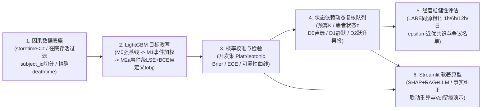

# icu-decision-agent 项目优化说明文档（V3 定稿执行版）

> **生效日期**：2026-11-21（同步自 `origin/main@177f2cc` 后升级）  
> **适用周期**：2026 年 11 月中期检查后 → 2027 年 4 月结题、软著与论文投稿  
> **定位**：取代已归档至 `docs/archive/` 的旧 H4/H5/H6 (CUGEW) 文档，作为整合 11 月 LARE/$\varepsilon$-策略集实现、11 月 18 日 B0–B7 修订结果与导师三项核心意见的**唯一优化技术规范**。

---

## 1. 当前项目现状与核心痛点诊断

### 1.1 代码库基线与外部产物现状（阶段 0 核查结果）

主干 `main` 已与远端同步至 `177f2cc`（标签 `v2026.11-midterm-sync`，核心无 DB 单元测试 90 passed）：

- **仓内已具备的 11 月模块**：受控粗化纯函数 `domain/labels/time_coarsening.py`、LARE 协议 `domain/models/lare.py`、LAR-Policy `domain/models/lar_policy.py`、$\varepsilon$-最优策略集 `domain/models/policy_set.py`、选择性复核与 PAC 安全网基线 `domain/models/selective_review.py` / `pac_safety_net.py`，以及 SHAP+RAG+LLM 解释链与 Streamlit 前端。
- **仍滞留仓外、待队友并入的模块**：
  1. 11 月 18 日 PPT 的 **8 模型全量体征对照（B0–B7，补齐 3,542 万条体征，AP=0.323/0.334，测试集 94,645 行 / 13,073 位病人，Brier=0.0096）** 源码与产物；
  2. 中期报告附录 B 的 `scripts/lare_controlled_validation.py`（93,673 stays 单时点受控粗化验证）。
- **口径冲突记录**：四套历史数字（旧 S2、旧 S2+v2 标签、中期单时点受控验证、11 月 18 日 B0–B7）的边界与作废状态已统一登记在 `docs/METRICS_LEDGER.md`。

### 1.2 仓内预测与取数管道核查出的 6 处具体工程缺陷

对本仓现有取数、特征与训练模块逐行审计，定位以下 **6 处必须在阶段 1 根治的底层缺陷**：

1. **化验缺 `storetime` 可用时间约束（且须防 `storetime IS NULL` 误删）**  
   `data_access/mimic_repo.py`（L178、L259）及 `domain/models/temporal/lab_temporal.py`（L259）、`train_grud.py`（L102）仅按 `charttime`（采血时间）过滤，未过滤 `storetime`（结果入库可用时间）。由于 MIMIC-IV 部分床旁/血气化验（如动脉乳酸）存在 `storetime IS NULL`，严禁直接写 `WHERE storetime <= t` 静默丢弃数据，须先做缺失比例审计并明确主/敏双口径。
2. **入科前化验锁死不更新**  
   `domain/features/build.py`（L194–200）采用 `if pre_icu_labs ... elif first_icu_labs ...`，导致有入科前化验的患者在 `h=1,2,4,6` 即使出了新化验也永远无法覆盖旧值。
3. **未剔除在预测时刻已死亡或已出科的样本**  
   `domain/features/build.py`（L292–297）对所有时刻无条件遍历全量 `icustays`，导致 `artifacts/models/metrics_mortality_12h.json` 五个时刻测试行数完全相同（均为 `18,891`）。已死亡/已出科病例进入后续时刻会直接污染动态复核队列。
4. **训练/推理缺失值处理严重不一致（Train-Serve Skew）**  
   `domain/models/lgbm.py`（L43–46）训练时将 `None` 转为 `np.nan`，但推理入口 `_load_feature_row`（L262–264）将 `None` **填成 `0`**（心率=0、pH=0），会直接破坏原型演示与事实纠正重算。
5. **`scale_pos_weight` 毁掉概率校准，旧 DCA 公式符号写反**  
   `domain/models/lgbm.py`（L68–74）强制 `scale_pos_weight = neg/pos`（约 83 倍），导致概率严重虚高（旧 v2 Brier 达 `0.151`，远劣于常数基线 `0.0118`）；旧 `domain/models/dca.py`（L134）把 `cost_ratio=4` 乘在 FP 惩罚上（反向放大误报代价 4 倍）是旧 H4 净受益恒负的代码根因。
6. **表结构与隐藏泄漏雷区**  
   `migrations/001_layer1_schemas.sql` 的 `feat.sample_matrix` 未存 `subject_id`；`mimic_repo.py`（L370）把全缺测 GCS 聚合为 `0`；`mimic_repo.py`（L547）误将出院结算编码 `diagnoses_icd` 标注为“入科前无泄漏”（严禁启用）。

### 1.3 导师指出的三个核心学术痛点

| 导师意见 | 暴露出的本质短板 | 本次优化的核心解法 |
| :--- | :--- | :--- |
| **问题一：只做了预警，决策还没做** | 只输出逐时点风险分 $p_{s,h}$ 或无记忆静态切分；同一危重病人跨时刻反复占满有限复核名额；单阈值固定预算退化为 Top-$K$（Jaccard=1.00） | 建立**状态依赖的容量受限动态复核队列模型**（D0 / D1 / D2 / D2-Dual），引入患者提醒状态转移与边际覆盖效用，统一改用**事件级首次覆盖**评价 |
| **问题二：LightGBM 只是调包** | 直接调用内置逐行二元交叉熵（BCE），同一次院内死亡的多条阳性记录重复计分，模型偏向反复拉高显性旧病例，未针对“首次发现新病例”定制目标 | 实施 **M0 → M1 → M2a 三层递进目标消融**：从事件归一/提前量加权（M1）升级至自定义 LightGBM `fobj` 的**事件级 Smooth-Max (LogSumExp) + BCE 混合目标（M2a）**，显式推导一阶梯度与严格正定凸 MM 二阶海森 |
| **问题三：公式改进了什么、创新点不够清晰** | 旧 H4/H5/H6 已被撤回；现有 `policy_set.py` 仅在单时点双阈值上枚举，未耦合动态决策空间，且需严格区分“同标签近优规则随机换人”与“标签时间精度不足导致的名额错配” | 将 `time_coarsening.py` 的**同源受控粗化（1h/6h/12h/日级）**与**多自由度策略空间上的 $\varepsilon$-近优策略集**绑定，给出共识/争议集划分与 $D_{\mathrm{cross}}$ vs $D_{\mathrm{within}}$ 严格归因判据 |

---

## 2. 总体优化架构（端到端闭环）

---

## 3. 针对导师三个核心问题的具体优化与算法公式

### 3.0 统一符号体系与因果数据定义

- **患者与住院切分**：患者 $u \in \mathcal{U}$，其 ICU 住院 $s \in \mathcal{S}_u$。严格按 **`subject_id`** 以 $60\% / 20\% / 20\%$ 分层切分训练/开发/独立测试集，同一患者多次住院绝不跨集。
- **多时点网格与在院存活资格集**：设预测偏移网格为 $\mathcal{H}$（旧版为 $\{0,1,2,4,6\}$；**建议新版升级为等距逐小时网格 $\mathcal{H} = \{1, 2, \dots, 12\}$ 或 $\{1, \dots, 24\}$**，使静默窗与跃升再报具备充分区分度）。预测绝对时刻 $t_{s,h} = \mathrm{intime}_s + h$，仅保留仍在院且存活的样本：
  $$\mathcal{E}_h = \Bigl\{ s \in \mathcal{S} \;\Big|\; t_{s,h} < \mathrm{outtime}_s \;\wedge\; \bigl(\mathrm{deathtime}_s \text{ is NULL} \;\vee\; t_{s,h} < \mathrm{deathtime}_s\bigr) \Bigr\}$$
- **严格因果特征 $\mathbf{x}_{s,h}$**：体征取 $\mathrm{charttime} \le t_{s,h}$；化验取 $\mathrm{storetime} \le t_{s,h}$（对 `storetime IS NULL` 做专项审计与双口径对比）；血管活性药取 $\mathrm{starttime} \le t_{s,h}$。包含最新值、窗口变化量/极值、缺测标志 $m_{s,h,j}$ 与距上次观测时长 $\Delta t_{s,h,j}$。
- **精确结局与事件级集合**：预测未来 $\Delta = 12\text{h}$ 院内死亡：
  $$y_{s,h} = \mathbb{I}\bigl\{\mathrm{deathtime}_s \in [t_{s,h},\, t_{s,h} + \Delta)\bigr\} \in \{0, 1\}$$
  记独立死亡事件集为 $\mathcal{S}^+ = \{s \mid \exists h \in \mathcal{H}_s,\; y_{s,h} = 1\}$；对每例 $s \in \mathcal{S}^+$，其阳性时点集 $P_s = \{h \in \mathcal{H}_s \mid y_{s,h} = 1\}$，数量 $m_s = |P_s| \ge 1$；阴性样本行集 $\mathcal{N} = \{(s,h) \mid y_{s,h} = 0\}$。

---

### 3.1 优化一：状态依赖的容量受限动态复核队列（解决“只做了预警，决策还没做”）

#### 原做法缺陷
原有静态触发 $a_{s,h}^{\mathrm{old}} = \mathbb{I}\{p_{s,h} \ge \tau\}$ 无历史状态：同一高危病例跨时刻反复占满复核名额 $K$；单时点单排序的固定预算优化会退化为静态 Top-$K$。

#### 优化后的决策模型与公式

1. **患者提醒状态与转移方程**  
   在时刻 $h$ 决策前，维护病例 $s$ 的历史状态三元组 $\mathbf{z}_{s,h} = (I_{s,h},\; \tau^{\mathrm{last}}_{s,h},\; p^{\mathrm{last}}_{s,h})$（此前是否已提醒、距上次提醒时长、上次提醒时校准风险概率）。执行动作 $a_{s,h} \in \{0,1\}$ 后因果转移至下一时刻 $h^+$：
   $$I_{s,h^+} = \max(I_{s,h},\, a_{s,h}), \qquad
   \tau^{\mathrm{last}}_{s,h^+} = \begin{cases} h^+ - h, & a_{s,h} = 1 \\ \tau^{\mathrm{last}}_{s,h} + (h^+ - h), & a_{s,h} = 0 \end{cases}, \qquad
   p^{\mathrm{last}}_{s,h^+} = \begin{cases} p_{s,h}, & a_{s,h} = 1 \\ p^{\mathrm{last}}_{s,h}, & a_{s,h} = 0 \end{cases}$$

2. **容量受限的状态依赖边际效用优化目标**  
   在总提醒配额 $K$（按每千在院小时允许触发 $B \in \{20, 50, 100\}$ 条报警折算）约束下，最大化期望边际事件覆盖效用：
   $$\max_{\pi \in \Pi} \; \mathbb{E}\!\left[\sum_{h \in \mathcal{H}} \sum_{s \in \mathcal{E}_h} a_{s,h}(\pi)\, U\bigl(p_{s,h},\, \mathbf{z}_{s,h}\bigr)\right] \qquad \text{s.t.} \quad \sum_{h \in \mathcal{H}} \sum_{s \in \mathcal{E}_h} a_{s,h}(\pi) \le K$$
   边际优先效用指数 $U(p_{s,h}, \mathbf{z}_{s,h})$ 定义为：
   $$U\bigl(p_{s,h},\, \mathbf{z}_{s,h}\bigr) = \begin{cases}
   p_{s,h}, & I_{s,h} = 0 \quad \text{（首次发现：完整覆盖边际价值）} \\
   0, & I_{s,h} = 1 \wedge \tau^{\mathrm{last}}_{s,h} \le T_{\mathrm{sil}} \wedge (p_{s,h} - p^{\mathrm{last}}_{s,h} \le \delta) \quad \text{（静默排重）} \\
   \rho\,\max\!\bigl(0,\, p_{s,h} - p^{\mathrm{last}}_{s,h}\bigr) + (1-\rho)\,p_{s,h}\,\mathbb{I}\{\tau^{\mathrm{last}}_{s,h} > T_{\mathrm{sil}}\}, & \text{其他（静默期满或显著恶化再报）}
   \end{cases}$$

3. **统一策略族下的四条对照策略**  
   定义门控允许函数（仅在建立基线并已首报后比较跃升 $\Delta p$，避免 `h=0→1` 首次体征到达引发假跃升）：
   $$\mathrm{Eligible}(s,h;\, T_{\mathrm{sil}}, \delta) = \mathbb{I}\!\left\{ I_{s,h}=0 \;\vee\; \tau^{\mathrm{last}}_{s,h} > T_{\mathrm{sil}} \;\vee\; \bigl(I_{s,h}=1 \wedge p_{s,h} - p^{\mathrm{last}}_{s,h} > \delta\bigr) \right\}$$
   - **D0（静态直选基线）**：$T_{\mathrm{sil}}=0,\; \delta=0$，$a_{s,h}=\mathbb{I}\{p_{s,h} \ge \tau\}$。
   - **D1（短期静默排重，对标 circEWS）**：$\delta=+\infty,\; T_{\mathrm{sil}} \in \{2,4,6,12,\infty\}$。
   - **D2（静默 + 风险跃升再报）**：$T_{\mathrm{sil}}>0,\; \delta \in (0,1)$；**界面展示风险概率 $p_{s,h}$ 与队列动作 $a_{s,h}$ 严格分离**。
   - **D2-Dual（三区动作扩展，承接 LARE 复核/升级权衡）**：引入 $\tau_{\mathrm{low}} < \tau_{\mathrm{high}}$ 划分**人工复核**（$a_{s,h}=1$）与**直接升级**（$a_{s,h}=2$），分别约束并报告两类负荷。

4. **统一事件级核心评价指标**（策略参数在开发集锁定，冻结后在测试集逐时点因果前向运行）：
   - 独立死亡事件首次覆盖率：$\mathrm{Cov}_{\mathrm{event}} = \frac{1}{|\mathcal{S}^+|} \sum_{s \in \mathcal{S}^+} \mathbb{I}\{\exists h \in P_s,\; a_{s,h} \ge 1\}$
   - 首次有效提醒提前时长：$\mathrm{Lead}(s) = \mathrm{deathtime}_s - \min\{t_{s,h} \mid h \in P_s,\; a_{s,h} \ge 1\}$（中位数与 IQR）
   - 每覆盖 1 例独立死亡所需报警数：$\mathrm{NNR}_{\mathrm{event}} = \frac{\sum_{s,h}\mathbb{I}\{a_{s,h}\ge 1\}}{\sum_{s\in\mathcal{S}^+}\mathbb{I}\{\exists h\in P_s,\; a_{s,h}\ge 1\}}$
   - 重复提醒占比、漏报事件数，配 **1,000 次按 `subject_id` 整组 Bootstrap 95% CI**。

---

### 3.2 优化二：LightGBM 事件级目标函数三层递进改写（解决“LightGBM 只是调包”）

#### 原公式局限
标准逐行 BCE $\mathcal{L}_{\mathrm{BCE}}(\mathbf{s}) = -\sum_{(s,h)} [y_{s,h}\log p_{s,h} + (1 - y_{s,h})\log(1 - p_{s,h})]$ 把同一次死亡的 $m_s$ 条记录当作 $m_s$ 个独立正样本，树分裂偏向反复抬高已被早期捕获的旧病例，而非首次捕获未覆盖新病例。

#### 三层递进消融框架（M0 → M1 → M2a）

1. **M0（无 `scale_pos_weight` 标准强基线）**：标准 `binary` 目标，移除 `scale_pos_weight`，输入新版全体征时序 + 缺测标志 $m$ + 观测间隔 $\Delta t$。
2. **M1（事件归一化与提前量加权）**：记平均每例死亡的阳性行数为 $\bar{m} = \frac{1}{|\mathcal{S}^+|}\sum_{s \in \mathcal{S}^+} m_s$，保持总阳性权重恒等于 $N_+$：
   - **M1a（事件等权归一）**：$w_{s,h} = \bar{m}/m_s$（$y_{s,h}=1$），$w_{s,h}=1$（$y_{s,h}=0$）。
   - **M1b（提前量偏好归一）**：令 $\tau_{s,h} = \mathrm{deathtime}_s - t_{s,h} \in (0, \Delta]$，偏好系数 $\kappa \ge 0$：
     $$u_{s,h} = 1 + \kappa \cdot \frac{\tau_{s,h}}{\Delta}, \qquad w_{s,h} = \begin{cases} \bar{m}\cdot \dfrac{u_{s,h}}{\sum_{h' \in P_s} u_{s,h'}}, & y_{s,h} = 1 \\ 1, & y_{s,h} = 0 \end{cases}$$
   *注*：Yèche et al. (ICML 2023) 的 Temporal Label Smoothing 改的是软标签 $\tilde{y}$ 而非样本权重 $w$，论文综述中须准确区分。M1 训练后须在开发集检查并重做概率校准。

3. **M2a（事件级 Smooth-Max (LogSumExp) + BCE 混合自定义目标 `fobj`，核心模型创新）**  
   对每次独立死亡事件 $s \in \mathcal{S}^+$，用带温度参数 $\tau > 0$ 的 Smooth-Max 聚合其阳性时点 logit $s_{s,h}$：
   $$\tilde{M}_s = \frac{1}{\tau} \log\!\left(\sum_{h' \in P_s} \exp(\tau\, s_{s,h'})\right), \qquad P_s^{\mathrm{ev}} = \sigma(\tilde{M}_s) = \frac{1}{1 + e^{-\tilde{M}_s}}, \qquad \ell^{\mathrm{ev}}_s(\mathbf{s}) = \log\!\bigl(1 + e^{-\tilde{M}_s}\bigr)$$
   构造与 M0 正负类先验梯度尺度严格守恒的混合目标（$\alpha \in [0, 1)$）：
   $$\mathcal{L}_{\mathrm{M2a}}(\mathbf{s}) = \sum_{(s,h) \in \mathcal{N}} \ell^{\mathrm{BCE}}_{s,h} \;+\; \sum_{s \in \mathcal{S}^+} \left[ (1 - \alpha) \sum_{h \in P_s} \ell^{\mathrm{BCE}}_{s,h} \;+\; \alpha\,\bar{m}\,\ell^{\mathrm{ev}}_s(\mathbf{s}) \right]$$
   - **精确一阶梯度**（定义事件内 Softmax 责任权重 $r_{s,h} = \frac{\exp(\tau s_{s,h})}{\sum_{h'\in P_s}\exp(\tau s_{s,h'})}$）：
     $$g_{s,h} = \frac{\partial \mathcal{L}_{\mathrm{M2a}}}{\partial s_{s,h}} = \begin{cases}
     p_{s,h}, & (s,h) \in \mathcal{N} \\[6pt]
     (1 - \alpha)(p_{s,h} - 1) - \alpha\,\bar{m}\,(1 - P_s^{\mathrm{ev}})\,r_{s,h}, & (s,h) \in P_s
     \end{cases}$$
   - **严格正定的凸 Majorization-Minimization (MM) 二阶海森**：  
     由于 $\ell^{\mathrm{ev}}_s$ 对原始 logit 的精确二阶导含负曲率项 $-\tau(1-P_s^{\mathrm{ev}})r_{s,h}(1-r_{s,h})$，直接传入 LightGBM 易导致牛顿步发散。利用 $\tilde{M}_s$ 的凸性在当前迭代点 $\mathbf{s}^{(k)}$ 处构造一阶线性化下界并代入单调减凸函数 $\log(1+e^{-u})$，得严格凸全局上界代理：
     $$\widehat{\ell}^{\mathrm{MM}}_s(\mathbf{s}; \mathbf{s}^{(k)}) = \log\!\left(1 + \exp\!\Bigl(-\tilde{M}_s(\mathbf{s}^{(k)}) - \sum_{h \in P_s} r_{s,h}^{(k)}\bigl(s_{s,h} - s_{s,h}^{(k)}\bigr)\Bigr)\right) \ge \ell^{\mathrm{ev}}_s(\mathbf{s})$$
     该上界在 $\mathbf{s}^{(k)}$ 处与原目标**函数值相等、一阶梯度完全一致**，其对角二阶海森严格正定：
     $$h_{s,h} = \begin{cases}
     p_{s,h}(1 - p_{s,h}), & (s,h) \in \mathcal{N} \\[6pt]
     (1 - \alpha)\,p_{s,h}(1 - p_{s,h}) + \alpha\,\bar{m}\,P_s^{\mathrm{ev}}(1 - P_s^{\mathrm{ev}})\,\bigl(r_{s,h}^{(k)}\bigr)^2, & (s,h) \in P_s
     \end{cases}$$
   - **关键检验性质**：$\alpha=0$ 或 $m_s=1$ 时精确退化为标准 BCE；初始低风险下阳性总梯度恒为 $-N_+$；单轮向量化复杂度 $O(N)$，确保每步牛顿更新单调下降。
   - **明确裁撤 M2b（成对首次覆盖排序）**：计算慢、缺失非对角海森且破坏概率尺度，易造成界面概率与队列排序逻辑冲突。

---

### 3.3 优化三：同源时间粗化（LARE）与多自由度 $\varepsilon$-近优策略集（解决“公式改进与创新点不够清晰”）

在仓内已有的 `domain/labels/time_coarsening.py`、`domain/models/lare.py` 与 `domain/models/policy_set.py` 基础上，将单时点双阈值网格升级为**优化一的多自由度决策参数空间 $\Theta$**（D2 的 $(\tau, T_{\mathrm{sil}}, \delta)$ 或 D2-Dual 的 $(\tau_{\mathrm{low}}, \tau_{\mathrm{high}}, T_{\mathrm{sil}}, \delta)$），彻底消除单排序固定预算下的 Top-$K$ 退化：

1. **同源受控粗化与同翻转率随机对照**：对同一 `deathtime` $T_s$ 构造粒度 $\Delta_g \in \{\text{exact}, 1\text{h}, 6\text{h}, 12\text{h}, 24\text{h}\}$ 的粗化区间 $I_g(T_s)$ 与重叠/保守判定标签 $y^{(g)}_{s,h}$，并配套同翻转率、时间无关的随机扰动对照 $y^{(\mathrm{rand}, g)}$。
2. **LARE 双对照分解**：实验 A 冻结策略换标签量化评价偏移；实验 B 在开发集按两套标签分别选规则，再在独立测试集统一用 $y^{\mathrm{exact}}$ 比较事件覆盖损失 $\Delta\mathrm{Cov}(g)$ 与住院级去重名单 $\mathrm{Jaccard}$。
3. **$\varepsilon$-近优策略集与多重性归因判据**：
   $$\mathcal{R}_\varepsilon(y) = \Bigl\{ \theta \in \Theta_{\mathrm{feas}} \;\Big|\; \widehat{J}_{\mathrm{dev}}(\theta; y) \ge \widehat{J}^*_{\mathrm{dev}}(y) - \varepsilon \Bigr\}$$
   同步检验临床绝对事件容差 $\varepsilon \in \{0, 1, 2, 5\}$ 例及开发集 1-SE 带宽，划分共识复核集 $S^{\mathrm{cons}}_\varepsilon(y) = \bigcap_{\theta \in \mathcal{R}_\varepsilon(y)} S_{\mathrm{rev}}(\theta)$ 与争议复核集 $S^{\mathrm{cont}}_\varepsilon(y) = \left(\bigcup_{\theta \in \mathcal{R}_\varepsilon(y)} S_{\mathrm{rev}}(\theta)\right) \setminus S^{\mathrm{cons}}_\varepsilon(y)$，并比较：
   $$D_{\mathrm{within}}(\varepsilon) = 1 - \min_{\theta_1, \theta_2 \in \mathcal{R}_\varepsilon(y^{\mathrm{exact}})} \mathrm{Jaccard}\!\bigl(S_{\mathrm{rev}}(\theta_1), S_{\mathrm{rev}}(\theta_2)\bigr)$$
   $$D_{\mathrm{cross}}(\varepsilon, g) = 1 - \max_{\theta_1 \in \mathcal{R}_\varepsilon(y^{\mathrm{exact}}),\; \theta_2 \in \mathcal{R}_\varepsilon(y^{(g)})} \mathrm{Jaccard}\!\bigl(S_{\mathrm{rev}}(\theta_1), S_{\mathrm{rev}}(\theta_2)\bigr)$$
   仅当 $D_{\mathrm{cross}}(\varepsilon, g) > D_{\mathrm{within}}(\varepsilon)$ 且患者级配对重抽样确认覆盖/代价变化显著时，方将名额置换归因于标签时间粗化。
4. **LAR-Policy 探索对照**：保留 `domain/models/lar_policy.py` 的 min-max 鲁棒选择作为探索对照，不确定性统一改用**患者级整组 Bootstrap**。

---

## 4. 明确裁撤与边界收缩清单

| 历史模块 / 想法 | 决定 | 依据 |
| :--- | :--- | :--- |
| 旧 H4 / H5 / H6 (CUGEW) | **彻底裁撤**（文档已入 `docs/archive/`） | 旧 H4 因 DCA 符号反了而恒负；旧 H6 仅是给 `scale_pos_weight` 补校准；新版 B5 自身已带体征时序 |
| M2b 成对首次覆盖排序 | **裁撤** | 算力开销大、缺失非对角海森、破坏概率尺度造成展示/排序冲突 |
| 全量 94k stays 重跑 GRU-D / TFT-lite | **可选附录（不阻塞主线）** | 本地 `train_grud.py` 仅 8 项且纯 CPU；优先补齐 B0–B7 对照，有 GPU 余力再补神经时序 |
| 遮蔽化验回填 / 事实纠正 | **收归 Streamlit 软著原型（VoI 演示）** | 验证“纠错后联动重算与留痕”，不冒充真人医生实验 |
| 科室层级床位调度 / 大模型解释大改 | **不展开 / 冻结投入** | 坚守独立 CDSS 边界，严控剩余 206 元经费 |
